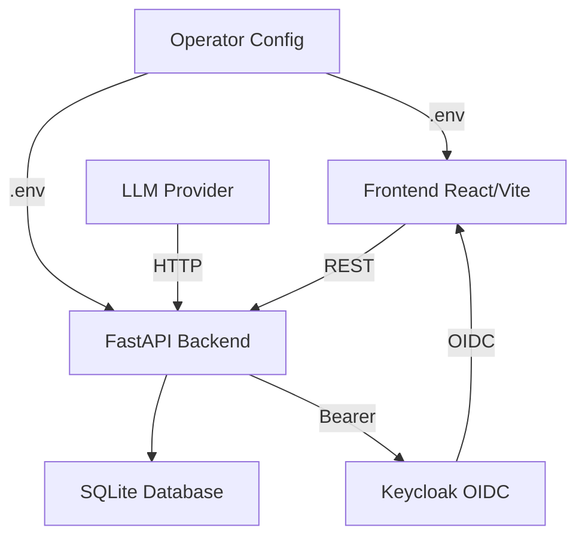

# Axiom Foundry | Alan Vo | AI & Machine Learning

> Work in progress. This checkpoint may be incomplete or fail tests. See PLAN.md and STATUS.md before use.


**Axiom Foundry** is a skill and configuration management platform for AI coding agents. It helps developers working with Claude Code, Codex, Cursor, OpenCode, Gemini, and Zed discover, organize, and export reusable agent skills from a single registry.

## Problem & Approach

AI coding agent ecosystems are fragmented: each platform (Claude Code, Codex, Cursor, etc.) uses different configuration formats, skill definitions, and extension mechanisms. Developers spend time hunting across documentation repositories instead of finding the right skill for their current task.

Axiom Foundry provides a centralized, searchable registry of agent skills with deterministic search, filtering, and pagination. The backend is a FastAPI application with SQLite persistence; the frontend is a React/TypeScript single-page application. The offline core requires no LLM key and works entirely through database queries and UI rendering.

## Quick Start

### Prerequisites

- Python 3.12+
- Node.js 24+
- Docker and Docker Compose (optional, for Keycloak-based auth)

### Backend

```bash
cd backend
python3 -m venv ../.venv
../.venv/bin/pip install -r requirements.txt
PYTHONPATH=backend .venv/bin/python -m uvicorn app.main:app --reload --port 8000
```

### Frontend

```bash
cd frontend
npm install
npm run dev
# Visit http://localhost:3000
```

### Tests

```bash
# Backend
PYTHONPATH=backend .venv/bin/python -m pytest backend/tests -v

# Frontend
cd frontend
npm test
npm run build
```

## Docker

```bash
docker compose -f compose.yaml up --build
# Backend: http://localhost:8000 (or http://127.0.0.1:8000)
# Frontend: http://localhost:3000
# Keycloak: http://localhost:8080
```

The compose file binds all ports to `127.0.0.1` for local-only development. Keycloak requires a PostgreSQL database (included in compose).

## Architecture



- **Frontend** (`frontend/`): React + TypeScript + Vite SPA. Typed API client, skill browsing, search, filtering, and detail view.
- **Backend** (`backend/`): FastAPI application with SQLAlchemy ORM, SQLite persistence, skill registry API, and (future) LLM adapter layer.
- **Keycloak** (`keycloak/`): Realm configuration with viewer, operator, and admin roles. SAML identity brokering configured for upstream IdPs.
- **Compose** (`compose.yaml`): Local development stack with nonroot containers and healthchecks.

## Features

- **Skill registry**: CRUD operations for AI coding agent skills (name, description, category, platform, capability, tags, configuration).
- **Search & filter**: Full-text search across name/description/tags, with category, platform, and capability filters.
- **Pagination & sorting**: Configurable page size (1–100), ascending/descending sort by any column.
- **Metadata endpoints**: Distinct categories, platforms, and capabilities for filter dropdowns.
- **Responsive UI**: Loading, error, and empty states; keyboard-accessible pagination.
- **Dockerized**: Multi-stage Docker builds, nonroot containers, healthchecks.

## API Endpoints

| Method | Path | Description |
|--------|------|-------------|
| GET    | `/api/skills/health` | Service health |
| GET    | `/api/skills` | List skills (paginated, filtered) |
| GET    | `/api/skills/{id}` | Get skill by ID |
| GET    | `/api/skills/name/{name}` | Get skill by name |
| POST   | `/api/skills` | Create a skill |
| PATCH  | `/api/skills/{id}` | Update a skill |
| DELETE | `/api/skills/{id}` | Delete a skill |
| GET    | `/api/skills/meta/categories` | List distinct categories |
| GET    | `/api/skills/meta/platforms` | List distinct platforms |
| GET    | `/api/skills/meta/capabilities` | List distinct capabilities |

### Query Parameters (`GET /api/skills`)

| Parameter   | Type | Default | Description |
|-------------|------|---------|-------------|
| `page`      | int  | 1       | Page number (≥ 1) |
| `page_size` | int  | 20      | Items per page (1–100) |
| `search`    | str  | —       | Full-text search term |
| `category`  | str  | —       | Filter by category |
| `platform`  | str  | —       | Filter by platform |
| `capability`| str  | —       | Filter by capability |
| `sort`      | str  | name    | Sort column |
| `order`     | str  | asc     | Sort direction (`asc` or `desc`) |

### Response Envelope

```json
{
  "items": [/* Skill objects */],
  "total": 42,
  "page": 1,
  "page_size": 20,
  "total_pages": 3
}
```

## AI/ML Evaluation

**Workflow**: Skill registry query performance (search, filter, pagination).

**Reproducible command**:

```bash
PYTHONPATH=backend .venv/bin/python -m pytest backend/tests -v
```

**Data provenance**: The backend test suite seeds a SQLite test database with three sample skills (tdd-workflow, security-review, frontend-dev) covering different categories, platforms, and capabilities. No external data sources are used.

**Baseline & measured results** (as of 2026-10-15):

| Suite         | Tests | Status |
|---------------|-------|--------|
| Backend (pytest) | 15 | All passing |
| Frontend (vitest) | 8 | All passing |
| Frontend (tsc build) | — | Passes |

**Failure cases**:
- Duplicate skill creation returns HTTP 409.
- Getting a non-existent skill returns HTTP 404.
- Search with no matches returns an empty result set (HTTP 200).
- Invalid sort column falls back to `name` (no crash).

## Provider Configuration

| Variable        | Default              | Description |
|-----------------|----------------------|-------------|
| `DATABASE_URL`  | `sqlite:///./axiom.db` | SQLite database URL |
| `LLM_PROVIDER`  | —                    | `openai`, `anthropic`, `gemini`, or `ollama` |
| `LLM_API_KEY`   | —                    | Required for LLM-powered features (optional) |
| `LLM_MODEL`     | —                    | Provider-specific model identifier |
| `LLM_BASE_URL`  | Provider default     | OpenAI-compatible base URL (optional) |

LLM features are opt-in. The skill registry and all offline functionality work without any LLM key. API errors are redacted and never leak key material.

## Security

- **OIDC authentication**: Keycloak with authorization-code flow, PKCE, and state/nonce validation. Roles: `viewer` (read-only), `operator` (create/update), `admin` (full). Admin composite role includes operator and viewer.
- **SAML brokering**: Keycloak configured for upstream SAML IdP via identity brokering. See `keycloak/realm-export.json` for realm setup.
- **Session management**: HttpOnly SameSite cookies with CSRF protection on write operations (planned).
- **Local demo mode**: Binds to `localhost` only; the server refuses demo mode in production (planned).
- **Secrets**: No real credentials are committed. Copy `.env.example` to `.env` and fill in values.
- **Rate limiting**: Not yet implemented.
- **HTTPS/TLS**: Terminate at the reverse proxy layer (e.g., nginx, Caddy, or cloud load balancer). The application itself does not serve TLS.

### SAML Setup

Keycloak supports upstream SAML IdPs through identity brokering. The included `keycloak/realm-export.json` defines the `axiom-foundry` realm with `viewer`, `operator`, and `admin` roles. To configure a SAML IdP:

1. Start Keycloak: `docker compose up -d keycloak`
2. Log in to the admin console at `http://localhost:8080` (admin/admin)
3. Navigate to **Identity Providers → Add provider → SAML**
4. Configure the SAML provider entity ID and metadata URL
5. Map SAML attributes to Keycloak user properties

## Project Layout

```
.
├── backend/
│   ├── app/
│   │   ├── main.py        # FastAPI application entrypoint
│   │   ├── api/           # REST route handlers
│   │   ├── models/        # SQLAlchemy models
│   │   ├── core/          # Database, config
│   │   └── services/      # Business logic
│   ├── tests/             # pytest integration tests
│   ├── requirements.txt   # Pinned dependencies
│   └── Dockerfile
├── frontend/
│   ├── src/
│   │   ├── api/client.ts  # Typed API client
│   │   ├── components/    # React components
│   │   ├── App.tsx        # Root component
│   │   └── main.tsx       # Entry point
│   ├── package.json
│   └── Dockerfile
├── keycloak/
│   └── realm-export.json  # Keycloak realm config
├── compose.yaml           # Docker Compose
├── .env.example           # Environment template
└── README.md
```

## Environment

Copy `.env.example` to `.env` and fill in values:

```bash
cp .env.example .env
```

Key variables:
- `DATABASE_URL`: SQLite path (default works for local dev)
- `KEYCLOAK_URL`, `KEYCLOAK_REALM`, `KEYCLOAK_CLIENT_ID`: OIDC configuration
- `LLM_API_KEY`, `LLM_PROVIDER`, `LLM_MODEL`, `LLM_BASE_URL`: LLM configuration (optional)
- `SECRET_KEY`: Used for session/token signing

## Backup & Restore

**SQLite database** (backend):

```bash
# Backup
sqlite3 axiom.db ".backup axiom.bak"

# Restore
sqlite3 axiom.db "RESTORE axiom.bak"
```

**Keycloak database** (PostgreSQL):

```bash
docker compose exec keycloak-db pg_dump -U keycloak keycloak > keycloak-backup.sql
docker compose exec keycloak-db psql -U keycloak keycloak < keycloak-backup.sql
```

## Limitations

- Authentication is configured in Keycloak but not yet wired into the application's route layer. All endpoints are currently unauthenticated.
- LLM adapter layer is not yet implemented; LLM configuration variables are present for future use.
- SQLite is used in development; production deployments should use PostgreSQL or MySQL.
- No rate limiting or audit logging yet implemented.

---

Alan Vo | alanvo@gmail.com | MIT License